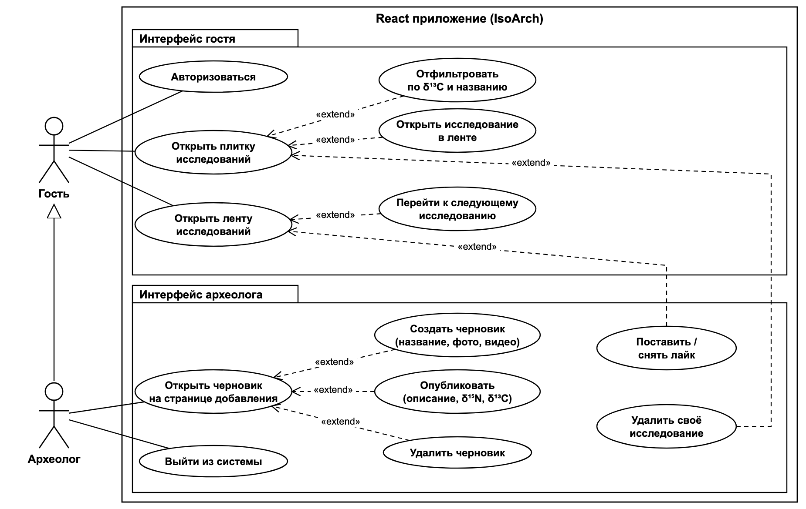

# ЛР6 — что и как сделано, подготовка к защите

**Тема:** «Завершение интерфейса пользователя в React». Вариант 18, «Изотопные сигнатуры».

Документ состоит из двух частей:
1. **Что и как сделано в ЛР6.** Требования, архитектура, Redux, кодогенерация, авторизация, прокси, страницы, проверка.
2. **Ответы на контрольные вопросы.** Redux Toolkit, axios, localStorage, CORS и обратный прокси, BFF и GraphQL, Next.js и SSG, FSD.

Описание страниц с кнопками и полями — в `README.md` в корне репозитория.

---

# Часть 1. Что и как сделано

## 1.1. Требования и как они выполнены

| Требование (`task.txt` и уточнения преподавателя) | Как сделано |
|---|---|
| Менеджер состояний Redux Toolkit для фильтра услуг | Слайс `signatures` хранит поля фильтра и применённый фильтр. Поля меняются обычными reducers, как в лекции 10 |
| Содержимое карточек — из веб-сервиса | Все данные приходят от бэкенда ЛР4 (FastAPI) |
| Mock при недоступном бэкенде (только гость) | Thunk ловит ошибку. Если пользователь — гость и бэкенд не отвечает (нет ответа или 5xx), возвращаются объекты из `mock.ts` |
| Фильтры в запросе к бэкенду | `GET /services?c13_max=…&filter=…`: δ¹³C (как в ЛР1/ЛР3) и поиск по названию |
| CORS решить проксированием, для S3 второй маршрут | Прокси Vite: `/api` → `:8000`, `/s3` → MinIO `:9000` |
| baseURL — `https://localhost:3000` (порт 3000 и https) | Dev-сервер работает по https, `API_BASE_URL = "https://localhost:3000/api"` |
| Страница добавления, кнопки удаления и лайков | Страница `/add`, «Удалить» в плитке, сердечко в ленте |
| Страница авторизации, переключение «Вход»/«Выход» | Страница `/login`. После входа в таббаре «Выход», сверху логин |
| При выходе сбрасывается фильтр | `useLogout` диспатчит `resetUserAction()` и `resetFilterAction()` |
| Услуги: axios + кодогенерация + redux-thunk | 7 thunk вызывают 7 сгенерированных методов |
| Авторизация: только axios, вручную в Redux, без thunk | `loginRequest` / `logoutRequest` на `axios.post`, затем `dispatch(setUserAction(...))` |
| Анимация, блокирующая кнопки, во время запросов | `LoadingOverlay` поверх приложения и `disabled` у кнопок |
| 9 запросов, все через axios; регистрацию не делаем | 7 запросов услуг + вход + выход. Регистрации, `/auth/me` и `fetch` в коде нет |
| Признак 0/1 только в Redux, в localStorage запрещено | Признак входа живёт только в store. По F5 интерфейс сбрасывается в гостя |
| Redux DevTools | Подключаются автоматически через `configureStore` |
| React Context запрещён, только функциональные компоненты | Context не используется. `Provider` из react-redux — это не наш Context |

## 1.2. Стек и запуск

React 19, TypeScript, Vite 8, React Router 7, React-Bootstrap. Новое в ЛР6:

| Пакет | Назначение |
|---|---|
| `@reduxjs/toolkit` | `configureStore`, `createSlice`, `createAsyncThunk`; redux-thunk встроен |
| `react-redux` | `Provider`, `useSelector`, `useDispatch` |
| `axios` | HTTP-клиент |
| `swagger-typescript-api` (dev) | Кодогенерация клиента по OpenAPI |
| `@vitejs/plugin-basic-ssl` (dev) | Самоподписанный сертификат для `https://localhost:3000` |

```bash
# бэкенд (репозиторий isoarch-service-backend)
docker compose up -d --wait     # PostgreSQL, Redis, MinIO, Adminer
.venv/bin/python main.py        # http://localhost:8000

# фронтенд
npm run dev                     # https://localhost:3000 — открывать именно с https://
npm run generate-api            # перегенерировать src/shared/api/Api.ts
```

Демо-пользователи: `archaeologist_main`, `researcher_petrov`, `student_sidorov`, пароль `StudyPassword123`.

## 1.3. Архитектура (FSD)

```
src/
├── app/        App.tsx (маршруты), AppLayout.tsx (таббар + анимация загрузки), store/ (Redux), styles/
├── processes/  пусто
├── pages/      tiles, feed, login, add
├── widgets/    tab-bar, top-nav, signature-grid, signature-slide
├── features/   c13-filter, auth, create-signature, delete-signature, toggle-like,
│               expand-description, next-signature
├── entities/   isotopic-signature (слайс + thunk + mock + карточка), user (слайс входа)
└── shared/     api/ (сгенерированный клиент), config/, lib/, ui/
```

Что добавилось в ЛР6 по слоям:

| Слой | Новое |
|---|---|
| `app/store` | `configureStore` с двумя редьюсерами: `signatures` и `user` |
| `entities/isotopic-signature/model/signaturesSlice.ts` | Состояние услуг, reducers фильтра, 7 thunk, `extraReducers`, хуки-селекторы |
| `entities/user/model/userSlice.ts` | `username`, `isAuthenticated`, reducers `setUser` / `resetUser` |
| `features/auth` | Ручные axios-запросы входа/выхода, форма входа, хук `useLogout` |
| `features/create-signature` | Формы создания черновика и публикации, предпросмотр медиа |
| `features/delete-signature`, `features/toggle-like` | Кнопки «Удалить» и лайк |
| `pages/login`, `pages/add` | Новые страницы |
| `shared/api` | `Api.ts` (кодогенерация) и экземпляр `api` |
| `shared/lib` | `apiError.ts` (ошибки), `redux.ts` (`useAppDispatch`), `useFilePreview.ts` |
| `shared/ui` | `LoadingOverlay`, общие стили форм и страниц |

Как соблюдено правило импортов FSD:
- **Store живёт в `app/`.** Нижние слои не могут импортировать его тип `RootState`. Поэтому каждый слайс экспортирует свои хуки-селекторы (`useSignatures`, `useIsAuthenticated`… по образцу `useData` из методички). Каждый такой хук описывает свою часть состояния локальным типом.
- **Thunk описывают нужную им часть состояния структурно.** Тип `ThunkState` = `{ signatures, user: { isAuthenticated } }`, без импорта из `entities/user`.
- **Соседние фичи друг друга не импортируют.** Кнопка удаления черновика попадает в `PublishDraftForm` слотом `deleteAction` со страницы. Кнопка «Удалить» попадает в карточку слотом `actions` из виджета.

## 1.4. Redux: состояние, действия, редьюсеры

### Store — `src/app/store/index.ts`

```ts
export const store = configureStore({
  reducer: combineReducers({
    signatures: signaturesReducer,
    user: userReducer,
  }),
});
```

`configureStore` сам подключает middleware `redux-thunk` и Redux DevTools. В `main.tsx` приложение обёрнуто в `<Provider store={store}>`.

### Слайс `user` — состояние после авторизации (лекция 10)

| Поле | Значение |
|---|---|
| `username` | Логин, показывается в верхней панели |
| `isAuthenticated` | Признак 0/1: гость или пользователь |

Reducers: `setUser({ username })` (вход) и `resetUser()` (выход). Thunk здесь нет: запросы делает компонент через axios, затем диспатчит обычный action. Состояние лежит только в оперативной памяти, поэтому по F5 приложение — снова гость. Это намеренный недостаток ЛР6. При этом cookie сессии в браузере остаётся, что видно во вкладке Application.

### Слайс `signatures` — услуги и фильтр

| Поле | Назначение |
|---|---|
| `filter: { c13Max, title }` | Значения полей ввода. Сохраняются при переходах между страницами |
| `appliedFilter: { c13Max, title }` | Фильтр, применённый кнопкой «Применить». Именно он уходит в запрос |
| `list` | Список карточек плитки, а также порядок для «Следующий» в ленте |
| `current` | Открытая в ленте запись |
| `draft` | Черновик пользователя на странице «Добавление» |
| `pending` | Счётчик выполняющихся запросов. Пока он больше 0, показывается анимация |
| `error` | Текст последней ошибки |
| `isMock` | `true`, если гостю показаны mock-данные |

Обычные reducers (поле фильтрации, лекция 10): `setC13Input`, `setTitleInput`, `applyFilter` (переносит поля в `appliedFilter` и ограничивает δ¹³C диапазоном −25…−10), `resetFilter`, `clearError`.

`extraReducers` (thunk, лекция 11):
- `addCase(thunk.fulfilled, …)` для каждого thunk кладёт результат в нужное поле. Например, `toggleLike.fulfilled` обновляет `is_liked` и `likes_count` и в `current`, и в `list`.
- `addMatcher(isPending(...thunks))` / `isFulfilled` / `isRejected` — общие стадии для всех 7 thunk: увеличить или уменьшить `pending`, записать `error`.

Счётчик `pending` вместо булева `loading` выбран потому, что в ленте одновременно идут два запроса (список и запись). С булевым флагом первый завершившийся запрос снял бы анимацию раньше времени.

### Thunk — 7 методов услуг

| Thunk | Сгенерированный метод | Запрос |
|---|---|---|
| `getSignaturesList` | `api.services.getServices` | `GET /services?c13_max=&filter=` (фильтр берётся через `getState`) |
| `getSignature` | `api.services.getFeedById` | `GET /services/feed/{id}` |
| `getDraft` | `api.services.getDraft` | `GET /services/draft` |
| `createDraft` | `api.services.createDraft` | `POST /services`, multipart: `title`, `image`, `video` |
| `publishDraft` | `api.services.publishDraft` | `PUT /services/{id}` |
| `deleteSignature` | `api.services.deleteService` | `DELETE /services/{id}` |
| `toggleLike` | `api.services.toggleLike` | `POST /services/{id}/like`, тело `{ like: 0 \| 1 }` |

Все thunk устроены одинаково: `try` → вызов метода → `return data`; `catch` → `rejectWithValue("понятное сообщение")`. У `getSignaturesList` и `getSignature` в `catch` есть ещё ветка mock (см. 1.7). Медиа-URL ответа сразу переписываются под прокси (`withMediaSrc`, см. 1.8).

### Пример полного цикла: «Применить» на плитке

```
клик «Применить»
  → dispatch(applyFilterAction())        обычный action: filter → appliedFilter
  → dispatch(getSignaturesList())        thunk (middleware redux-thunk)
       pending   → pending += 1          → появляется LoadingOverlay, кнопки disabled
       getState().signatures.appliedFilter
       api.services.getServices({ c13_max, filter })  → axios → https://localhost:3000/api/services?...
                                                       → прокси Vite → http://localhost:8000/services?...
       fulfilled → list = data, pending -= 1
  → useSelector(useSignatures) видит новый list → TilesPage перерисовывается → карточки через props
```

## 1.5. Кодогенерация (лекция 11, слайд 12)

`scripts/generate-api.mjs` вызывает `generateApi` из `swagger-typescript-api`:
- **Источник:** схема `http://localhost:8000/openapi.json` (или файл из `OPENAPI_FILE`).
- **Клиент:** `httpClientType: 'axios'`. Генерируется класс `HttpClient` с `axios.create(...)` и класс `Api` с методами.
- **Белый список `SERVICE_ROUTES`.** Хук `onCreateRoute` оставляет только 7 маршрутов услуг. Методов входа, выхода и регистрации в `Api.ts` нет: они пишутся вручную.
- **Имена методов.** Хук `onFormatRouteName` превращает FastAPI-шный operationId (`get_services_services_get`) в имя функции бэкенда (`getServices`). Методы сгруппированы по первому сегменту пути: `api.services.*`.
- **Результат:** `src/shared/api/Api.ts`. Типы тоже сгенерированы: `ServiceResponse`, `ServiceDraftResponse`, `PublishRequest`, `LikeResponse`… Тип сущности `IsotopicSignature` — это и есть `ServiceResponse`, поэтому фронтенд и бэкенд не расходятся в полях.

Экземпляр клиента — `src/shared/api/index.ts`:

```ts
export const api = new Api({ baseURL: API_BASE_URL, withCredentials: true });
```

`Api.ts` руками не правится, его только перегенерируют. Поэтому в нём остаются комментарии генератора (`@tags Изотопные исследования`, `@request GET:/services`): по ним видно соответствие Swagger.

## 1.6. Авторизация (лекция 10)

- **Вход.** `LoginForm` хранит поля в локальном `useState`. На submit вызывается `loginRequest` (`axios.post('/auth/login')`). При успехе — `dispatch(setUserAction({ username }))` и переход туда, откуда пришли (`location.state.from`, иначе плитка). При 401 показывается «Неверный логин или пароль». Пока идёт запрос, кнопка заблокирована и видна анимация (локальный `loading`).
- **Выход.** Хук `useLogout`: `logoutRequest` (`axios.post('/auth/logout')`), затем `resetUserAction()` и `resetFilterAction()`. Если сессия на сервере уже истекла, интерфейс всё равно возвращается к гостю.
- **Сессия.** Бэкенд ставит cookie `session_id` (HttpOnly, SameSite=Lax). Браузер прикладывает её сам, потому что запросы идут на тот же origin `https://localhost:3000` через прокси. JavaScript cookie прочитать не может (HttpOnly). Это защита от XSS.
- **Гость и пользователь в интерфейсе:**

| Элемент | Гость | Пользователь |
|---|---|---|
| Таббар | Лента, ~~Добавление~~ (приглушено), Плитка, **Вход** | Лента, Добавление, Плитка, **Выход** |
| Верхняя панель | Логотип | Логотип + логин |
| Карточки в плитке | Без «Удалить» | «Удалить» у своих записей (`is_creator === 1`) |
| Сердечко в ленте | Число лайков; клик ведёт на «Вход» | Ставит и снимает лайк |
| `/add` | Перенаправляет на `/login` | Страница добавления |

- **После F5.** Cookie живёт, поэтому бэкенд по-прежнему присылает персональные `is_creator` / `is_liked`. Но Redux уже в состоянии гостя. Поэтому интерфейс учитывает эти флаги **только при `isAuthenticated`**, иначе гость увидел бы кнопки «Удалить».

## 1.7. Mock-данные при недоступном бэкенде

```ts
const canUseMock = (error, state) =>
  !state.user.isAuthenticated && isBackendUnavailable(error);
```

- `isBackendUnavailable`: у axios-ошибки нет `response` (сеть) или статус ≥ 500. Если на `:8000` никто не слушает, прокси Vite отвечает 502.
- В mock-ветке `getSignaturesList` фильтрует `ISOTOPIC_SIGNATURES_MOCK` теми же правилами, что и бэкенд: δ¹³C ≤ порога и подстрока названия без учёта регистра. Ставится `isMock = true`, и на плитке появляется плашка «Сервер недоступен — показаны демонстрационные данные».
- Авторизованному пользователю mock не подставляется: он видит ошибку. Так требует задание: mock только для гостя.
- Mock-объекты полностью соответствуют сгенерированному типу `ServiceResponse`. Пустые `image_url` / `video_url` заменяются медиа по умолчанию из `public/`.

## 1.8. Прокси, https и медиа из MinIO

`vite.config.ts`:

```ts
const proxy = {
  '/api': { target: 'http://localhost:8000', changeOrigin: true, rewrite: (p) => p.replace(/^\/api/, '') },
  '/s3':  { target: 'http://localhost:9000', changeOrigin: true, rewrite: (p) => p.replace(/^\/s3/, '') },
}
plugins: [react(), basicSsl()], server: { port: 3000, strictPort: true, proxy }
```

- Браузер общается только с `https://localhost:3000`, то есть с одним origin. Запросов на другой origin нет, и CORS не возникает.
- Бэкенд отдаёт медиа прямыми ссылками MinIO: `http://localhost:9000/isoarchservice/<uuid>.png`. Функция `toMediaSrc` превращает их в `/s3/isoarchservice/<uuid>.png`, это второй маршрут прокси. Заглушки бэкенда `/static/...` заменяются своими `public/default_signature.{png,mp4}`. При ошибке загрузки (`onError`) тоже подставляется медиа по умолчанию.
- На http адрес `http://localhost:3000` не откроется: сервер говорит только по TLS.

## 1.9. Страницы и поток данных

- **Плитка `/`.**
  - При открытии вызывается `dispatch(getSignaturesList())`.
  - Поля фильтра берутся из store, в компоненты передаются props (лекция 8, слайд 11).
  - «Применить» / «Сбросить» — обычный action + thunk.
  - «Удалить» — `deleteSignature(id)`, затем запись убирается из `list` в `fulfilled`.
- **Лента `/feed/:id`.**
  - Текущая запись загружается через `getSignature(id)`.
  - Список нужен для «Следующий»: берётся следующий индекс по кругу в порядке плитки с учётом фильтра.
  - `/feed` без id переходит на первую запись списка.
  - Лайк — `toggleLike`.
- **Вход `/login`** — см. 1.6.
- **Добавление `/add`** (только после входа):
  1. `getDraft` проверяет, есть ли незавершённый черновик (он у пользователя может быть только один).
  2. Без черновика показывается `CreateDraftForm`: название, фото, видео. Выбранные файлы сразу видны через `URL.createObjectURL`. «Далее» вызывает `createDraft` (multipart).
  3. С черновиком показывается `PublishDraftForm`: описание, δ¹⁵N, δ¹³C. «Опубликовать» вызывает `publishDraft`, после чего открывается лента. «Удалить черновик» вызывает `deleteSignature`.
- **Анимация и ошибки.**
  - `AppLayout` показывает `LoadingOverlay`, пока `pending > 0`. Полупрозрачный слой `position: fixed` перехватывает клики, кнопки дополнительно получают `disabled`.
  - Ошибки показываются в `Alert`. `getErrorMessage` даёт русский текст по HTTP-коду, для 422 — сообщения валидации FastAPI.

## 1.10. Как проверено

- `npm run build` (проверка типов) и `npm run lint` (oxlint) — без ошибок и предупреждений.
- Сценарий в headless Chromium с настоящим бэкендом (PostgreSQL, Redis, MinIO):
  - гость: плитка из БД, фильтр в запросе `GET /services?c13_max=-18.5&filter=погреб`, лента, медиа через `/s3`;
  - вход трёх демо-пользователей;
  - создание черновика с файлами, публикация, лайк и снятие лайка, «Следующий», удаление своей записи;
  - выход со сбросом фильтра; F5 → гость.
- Тот же сценарий с остановленным бэкендом: 6 mock-карточек, плашка, фильтр по mock. Лайк гостя ведёт на вход. Попытка войти показывает ошибку.

## 1.11. Порядок показа на защите (скриншоты 1–16)

| № | Что показать | Где |
|---|---|---|
| 1–2 | Плитка и лента на mock | Бэкенд остановлен, `https://localhost:3000` |
| 3–6 | Плитка, лента, вход, добавление | Бэкенд запущен |
| 7–8 | Изменение строки в БД и результат во фронтенде | Adminer `http://localhost:8080` → `isotopic_signatures`, затем F5 |
| 9 | Вход → F5 → гость, cookie `session_id` осталась | DevTools → Application → Cookies; Local Storage пуст |
| 10 | Плитка пользователя с признаком удаления | Postman, `GET http://localhost:8000/services` с заголовком `Cookie: session_id=…` → `is_creator: 1` |
| 11 | Все состояния Redux | `signaturesSlice.ts`, `userSlice.ts`, `app/store`, Redux DevTools → State |
| 12 | axios в кодогенерации | `Api.ts` (`import axios`, `axios.create`), `generate-api.mjs` (`httpClientType: 'axios'`) |
| 13 | Сгенерированный код в thunk | `signaturesSlice.ts`: `createAsyncThunk` + `api.services.*` |
| 14 | Методы названы по теме | `Api.ts` (`services = {…}`) рядом со Swagger `http://localhost:8000/docs` |
| 15 | AJAX через прокси | Network → Fetch/XHR: `https://localhost:3000/api/services?...` |
| 16 | Изображения из MinIO | Network → Img: `/s3/isoarchservice/<uuid>.png` + консоль MinIO `http://localhost:9001` |

## 1.12. Диаграммы для РПЗ

Файлы лежат в `docs/diagrams/` (рядом с этим документом): PNG для отчёта и SVG как векторный исходник. В РПЗ они стоят на рисунках 1, 2 и 4.



**Диаграмма прецедентов** (`use_case_diagram`, рисунок 1 РПЗ):
- **Роли этого года** (лекция 11, слайд 15): **Гость** и **Исследователь**, он же создатель, то есть авторизованный пользователь. Модератора нет: в ЛР4 `moderator_id` всегда `NULL`.
- **Обобщение** «Исследователь → Гость» (сплошная линия с полым треугольником): исследователь может всё, что гость, плюс прецеденты своего интерфейса.
- **Интерфейс гостя:**
  - посмотреть каталог исследований, к нему `«extend»` — отфильтровать по δ¹³C и названию, открыть исследование из каталога;
  - посмотреть исследование в ленте, к нему `«extend»` — перейти к следующему, раскрыть описание рациона;
  - авторизоваться. Регистрации нет: в ЛР6 её не делаем.
- **Интерфейс исследователя:**
  - поставить / снять лайк;
  - удалить своё исследование;
  - добавить исследование (название, фото, видео), к нему `«extend»` — просмотреть выбранные фото и видео и посмотреть черновик. К черновику, в свою очередь, `«extend»` — указать описание, указать δ¹⁵N и δ¹³C, опубликовать, удалить черновик;
  - выйти из системы.
- **`«extend»`** (пунктир со стрелкой к базовому прецеденту) — необязательное расширение: оно выполняется не всегда.

**ER-диаграмма** (`er_diagram`, рисунок 2 РПЗ) повторяет реальную схему БД ЛР4:
- `image_file` / `video_file` — ключи объектов MinIO;
- `moderator_id` и `completed_at` у исследования;
- `created_at` у всех трёх таблиц;
- две связи `users` → `isotopic_signatures`: создатель (обязательная) и модератор (необязательная).

**Диаграмма последовательности** (`sequence_diagram`, рисунок 4 РПЗ) — сценарий ЛР6, как его выполняет фронтенд:
- вход;
- каталог с фильтром;
- проверка черновика, создание, публикация;
- повторная загрузка списка;
- лента;
- фото и видео из MinIO через `/s3`;
- лайк;
- следующее исследование по `id` из списка каталога;
- выход.

К домену «Исследования» идут 8 запросов, к MinIO — 2. На эти 10 запросов опирается расчёт RPS в РПЗ.

---

# Часть 2. Контрольные вопросы

## 2.1. Схема Redux Toolkit: reducer, store, middleware

**Запомни:** «Компонент не меняет данные сам. Он отправляет action через dispatch. Middleware может перехватить action и выполнить запрос. Reducer по action вычисляет новое состояние. Store хранит его, а useSelector доставляет его в компоненты».

```
            ┌────────────────────────── Store ──────────────────────────┐
 UI ──dispatch(action)──▶ Middleware (thunk, devtools…) ──▶ Reducer(state, action) ──▶ новый State
  ▲                          │  ▲                                                       │
  │                          ▼  │ dispatch(pending/fulfilled/rejected)                  │
  │                         API (axios)                                                 │
  └───────────────────────────── useSelector ◀──────────────────────────────────────────┘
```

- **Action** — объект `{ type, payload }`, описание того, *что произошло*. В RTK action creators генерирует `createSlice`: `setC13InputAction("-18")` → `{ type: "signatures/setC13Input", payload: "-18" }`.
- **Reducer** — чистая функция `(state, action) => newState`: без запросов, случайностей и побочных эффектов. В `createSlice` можно писать «мутирующий» код (`state.list = payload`). Библиотека Immer внутри превращает его в неизменяемое обновление: создаётся новый объект, поэтому React видит изменения.
- **Store** — единственное хранилище состояния всего приложения. Методы: `getState()`, `dispatch(action)`, `subscribe()`. Создаётся `configureStore`, корневой reducer собирается из слайсов (`combineReducers`). В компоненты передаётся через `<Provider>`.
- **Slice** (`createSlice`) — часть состояния вместе со своими reducers и action creators: `name`, `initialState`, `reducers`, `extraReducers`.
- **Selector** — функция чтения из store. `useSelector(s => s.signatures.list)` подписывает компонент: он перерисуется, только если выбранное значение изменилось.
- **Middleware** — функция между dispatch и reducer: `store => next => action => …`. Применяется для логирования, отчётов об ошибках, асинхронных запросов. По умолчанию `configureStore` подключает:
  - `redux-thunk`, который позволяет диспатчить не объект, а функцию `(dispatch, getState) => …`;
  - в режиме разработки — проверки неизменяемости и сериализуемости.
  
  Redux DevTools подключается как enhancer.
- **Thunk** (`createAsyncThunk`) — action creator, который сам выполняет запрос. Он автоматически диспатчит три action:

| Стадия | Когда | У нас |
|---|---|---|
| `pending` | Запрос начался | `pending += 1`, `error = null` |
| `fulfilled` | Успех, `return data` | Данные в `list` / `current` / `draft` |
| `rejected` | Ошибка, `rejectWithValue(...)` | `error = сообщение` |

  Эти стадии обрабатываются в `extraReducers`: `builder.addCase(...)` / `addMatcher(...)`.
- **Отличие от лекции 10.** В варианте лекции 10 (авторизация) запрос делает компонент, а в Redux попадает уже готовый результат обычным action. В варианте лекции 11 (услуги) запрос спрятан в thunk, а компонент только диспатчит `getSignaturesList()`.

**Могут спросить:**
- «Почему reducer должен быть чистым?» Тогда при одних и тех же state и action результат всегда одинаков. На этом держатся DevTools (перемотка истории) и сравнение по ссылке при перерисовке.
- «Где хранить загрузку?» В слайсе. У нас это `pending`, и стадии всех thunk меняют его через `addMatcher`.
- «Чем RTK лучше «голого» Redux?» Меньше шаблонного кода: action types и creators генерируются сами, Immer позволяет писать мутирующий код, `configureStore` сам подключает thunk и DevTools.
- «Redux vs Context?» Context только передаёт значение вниз по дереву. Redux — это предсказуемая модель обновлений (action → reducer), middleware, DevTools и подписка с выборочной перерисовкой. В нашем курсе Context запрещён.

## 2.2. Axios

**Запомни:** «Axios — HTTP-клиент на промисах. Он сам превращает объекты в JSON и обратно, отклоняет промис при статусе вне 2xx и умеет задавать общие настройки через экземпляр».

| | `fetch` | `axios` |
|---|---|---|
| JSON в запросе | Нужно `JSON.stringify` и заголовок `Content-Type` | Объект передаётся как есть |
| JSON в ответе | `await response.json()` | Сразу `response.data` |
| Ошибки HTTP (404, 500) | Промис **выполняется**, нужно проверять `response.ok` | Промис **отклоняется**, сразу попадаем в `catch` |
| Общие настройки | Нет механизма по умолчанию | `axios.create({ baseURL, withCredentials, headers })`, `axios.defaults` |
| Перехватчики | Нет | `interceptors.request` / `interceptors.response` (например, токен в каждый запрос, обработка 401) |
| Отмена, таймаут | `AbortController` | `signal: AbortController`, опция `timeout` |
| Cookie на чужой origin | `credentials: 'include'` | `withCredentials: true` |

У нас axios используется двумя способами:
1. **Через кодогенерацию** (услуги). `HttpClient` в `Api.ts` создаёт экземпляр `axios.create({ baseURL: "https://localhost:3000/api", withCredentials: true })`, и каждый метод вызывает `this.instance.request(...)`. Для `createDraft` тело передаётся как `FormData` (`ContentType.FormData`), браузер сам добавляет `boundary`.
2. **Вручную** (вход и выход). `axios.post(\`${API_BASE_URL}/auth/login\`, credentials)`.

Ошибки разбираются через `isAxiosError(error)`:
- `error.response.status` — HTTP-код;
- `error.response.data.detail` — сообщение FastAPI;
- отсутствие `error.response` — сеть недоступна.

**Могут спросить:**
- «Почему ответ 404 попадает в `catch`?» У axios по умолчанию `validateStatus` пропускает только 2xx.
- «Что такое interceptor?» Функция, которая выполняется перед каждым запросом или после каждого ответа экземпляра. Например, при JWT в ней добавляют заголовок `Authorization: Bearer …`.

## 2.3. localStorage

**Запомни:** «localStorage — хранилище строк «ключ–значение» в браузере, своё для каждого origin. Данные переживают F5 и закрытие браузера, на сервер сами не отправляются, но доступны любому JS на странице».

- **API:** `localStorage.setItem("k", JSON.stringify(obj))`, `JSON.parse(localStorage.getItem("k"))`, `removeItem`, `clear`. API синхронный, хранит только строки, объём около 5–10 МБ.
- **Область видимости:** origin, то есть схема + хост + порт. `https://localhost:3000` и `http://localhost:8000` — разные хранилища.
- **Сравнение хранилищ:**

| | localStorage | sessionStorage | Cookie |
|---|---|---|---|
| Срок жизни | Пока не удалят | До закрытия вкладки | `Max-Age` / `Expires` или до закрытия браузера |
| Отправляется на сервер | Нет | Нет | Да, с каждым запросом к своему домену |
| Доступ из JS | Да | Да | Нет, если `HttpOnly` |
| Объём | ~5–10 МБ | ~5 МБ | ~4 КБ |

- **Безопасность.** Любой внедрённый скрипт (XSS) прочитает localStorage. Поэтому секреты там хранить рискованно, а HttpOnly-cookie скрипт прочитать не может.
- **Правило курса (лекция 11, слайд 14).** В localStorage можно хранить только JWT. Признак 0/1 «гость/пользователь» хранить там запрещено. Поэтому по F5 интерфейс сбрасывается в гостя, либо нужен повторный запрос входа.
- **У нас.** Авторизация на серверной сессии: сессия лежит в Redis, браузеру отдаётся HttpOnly cookie `session_id`. JWT нет, поэтому localStorage пуст. На скриншоте 9 видно: cookie осталась, Local Storage пуст, Redux после F5 в состоянии гостя.

**Могут спросить:**
- «Как сделать, чтобы после F5 пользователь не пропадал?» При старте вызывать `GET /auth/me`: cookie жива, значит, восстанавливаем `user`. Либо хранить JWT в localStorage и проверять его. В ЛР6 это намеренно не делается.

## 2.4. CORS и обратный прокси

**Запомни:** «Браузер по политике одного источника не даёт JS читать ответы с другого origin, если сервер явно не разрешил это заголовками CORS. Обратный прокси убирает проблему: браузер ходит только на свой origin, а прокси уже сам обращается к бэкенду».

- **Origin** = схема + хост + порт. Страница на `https://localhost:3000` и API на `http://localhost:8000` — разные origin (отличаются схема и порт).
- **Same-Origin Policy.** JS может отправить запрос на чужой origin, но **прочитать ответ** сможет, только если сервер вернёт `Access-Control-Allow-Origin: https://localhost:3000`. Для запросов с cookie сервер должен вернуть ещё `Access-Control-Allow-Credentials: true`, и тогда `*` запрещена.
- **Preflight.** Перед «непростыми» запросами (PUT, DELETE, `Content-Type: application/json`, свои заголовки) браузер отправляет `OPTIONS` с `Access-Control-Request-Method` / `-Headers`. Если сервер не разрешил, основной запрос не отправляется.
- **CORS — механизм браузера.** Postman и curl его не применяют, поэтому там «всё работает».
- **Обратный прокси (reverse proxy)** — сервер перед бэкендом. Клиент считает, что общается с ним, а прокси пересылает запросы дальше. Прямой (forward) прокси работает наоборот: он на стороне клиента и ходит в интернет от его имени.
- **У нас.** Dev-сервер Vite (на базе `http-proxy`) работает обратным прокси:
  - `https://localhost:3000/api/services` → `http://localhost:8000/services` (`rewrite` срезает `/api`);
  - `https://localhost:3000/s3/isoarchservice/x.png` → `http://localhost:9000/isoarchservice/x.png` (второй маршрут, для S3 / MinIO);
  - `changeOrigin: true` подменяет заголовок `Host` на адрес цели.
  
  Браузер видит один origin, поэтому CORS не нужен. Cookie `session_id` тоже ставится на `localhost:3000` и автоматически уходит с каждым запросом.
- **В продакшене** ту же роль выполняет nginx: раздаёт собранный `dist/` и проксирует `location /api/` на бэкенд. Плюсы: один домен, TLS в одном месте, балансировка, кеширование, бэкенд не открыт наружу.

**Могут спросить:**
- «Почему в Network запрос идёт на порт 3000, а не 8000?» Браузер обращается к прокси, а к бэкенду идёт уже сам Vite (скриншот 15).
- «Можно ли было решить CORS на бэкенде?» Да, через `CORSMiddleware` в FastAPI с `allow_origins=["https://localhost:3000"]` и `allow_credentials=True`. Но по заданию CORS решается проксированием.

## 2.5. BFF и GraphQL

**Запомни:** «BFF — отдельный бэкенд под конкретный фронтенд, который собирает и подгоняет данные для него. GraphQL — язык запросов, в котором клиент сам описывает, какие поля ему нужны, и получает их одним запросом к одному endpoint».

### BFF (Backend for Frontend)

- **Проблема.** У веба, мобильного приложения и админки разные потребности. Один универсальный API заставляет клиентов делать много запросов и получать лишние поля. Или наоборот: бэкенд обрастает частными случаями.
- **Решение.** Тонкий серверный слой для каждого клиента: «BFF для веба», «BFF для мобилки». Он:
  - агрегирует несколько микросервисов в один ответ;
  - подгоняет формат под экран;
  - держит секреты и токены на сервере, а браузеру выдаёт cookie-сессию;
  - снимает проблему CORS, потому что живёт на том же origin, что и фронтенд.
- **Минусы.** Ещё один сервис, который нужно поддерживать, и возможное дублирование логики между разными BFF.
- **Связь с нашей работой.** Наш прокси Vite — простейший прообраз: один origin для браузера, а за ним два разных сервиса (FastAPI и MinIO). Настоящий BFF вдобавок менял бы данные. Например, сам переписывал бы ссылки MinIO, а не `toMediaSrc` на фронтенде.

### GraphQL

- **Один endpoint** (`POST /graphql`) и **строго типизированная схема** (SDL). Клиент отправляет запрос с перечнем полей:

```graphql
query {
  services(c13Max: -18, filter: "погреб") {
    id
    title
    deltaC13
    likesCount
    creator { username }
  }
}
```

- **Операции:**
  - `query` — чтение;
  - `mutation` — изменение, например `toggleLike(id: 1, like: 1) { likesCount }`;
  - `subscription` — поток событий через WebSocket.
- **Плюсы:**
  - нет over-fetching: приходят только запрошенные поля;
  - нет under-fetching: связанные данные (услуга + автор) приходят одним запросом;
  - схема — живой контракт и документация, по ней тоже работает кодогенерация (GraphQL Code Generator, аналог `swagger-typescript-api`).
- **Минусы:**
  - сложнее HTTP-кеширование (всё идёт через POST на один URL);
  - проблема N+1 на сервере (решается DataLoader);
  - нужно ограничивать глубину и сложность запросов;
  - коды ответа почти всегда 200, ошибки приходят в поле `errors`.
- **REST vs GraphQL у нас.** У нас REST: ресурсы `/services`, `/services/{id}`, методы HTTP, коды 200/201/204/401/404, контракт — OpenAPI (Swagger). Для «плитки» REST отдаёт все поля записи, а GraphQL отдал бы только нужные карточке.
- **BFF и GraphQL часто совмещают:** GraphQL-сервер выступает BFF, собирая данные из REST-микросервисов.

## 2.6. Next.js и SSG

**Запомни:** «Next.js — фреймворк поверх React с маршрутизацией по файлам и рендерингом на сервере. SSG — генерация готового HTML на этапе сборки: страница отдаётся мгновенно и хорошо индексируется».

- **Next.js добавляет к React:**
  - файловую маршрутизацию (`app/feed/[id]/page.tsx` → `/feed/:id`);
  - серверные компоненты;
  - API-маршруты (`app/api/.../route.ts`, по сути готовый BFF);
  - оптимизацию изображений;
  - разные стратегии рендеринга для разных страниц.
- **Стратегии рендеринга:**

| Стратегия | Когда строится HTML | Пример использования |
|---|---|---|
| **CSR** (Client-Side Rendering) | В браузере, после загрузки JS | Наше Vite SPA: сервер отдаёт пустой `<div id="root">` |
| **SSR** (Server-Side Rendering) | На сервере на каждый запрос | Персональные данные, всегда свежие |
| **SSG** (Static Site Generation) | Один раз при `next build` | Документация, блог, каталог, который редко меняется |
| **ISR** (Incremental Static Regeneration) | Как SSG, но страница пересобирается в фоне раз в N секунд | Каталог, который иногда обновляется |

- **SSG в Next.js.**
  - App Router: страница без динамических данных собирается статически. Для динамических путей используется `generateStaticParams()`, который возвращает список `id`, и под каждый строится HTML. `export const revalidate = 60` включает ISR.
  - Pages Router: `getStaticProps` + `getStaticPaths`.
- **Плюсы SSG:** HTML готов заранее и раздаётся с CDN, быстрая первая отрисовка, хорошее SEO, сервер почти не нагружается. **Минусы:** данные устаревают до следующей сборки или ревалидации, не подходит для персональных страниц.
- **Гидратация.** Браузер получает готовый HTML, затем загружается JS, и React «оживляет» разметку: навешивает обработчики, дальше страница работает как SPA.
- **Применительно к IsoArch.** Публичную плитку и ленту можно было бы сделать через SSG/ISR: опубликованные записи меняются редко, их хорошо индексировать. Страницы «Добавление» и персональные кнопки остались бы клиентскими или SSR, потому что зависят от сессии. Наш проект — CSR на Vite: в Network первым приходит пустой документ, а данные загружаются AJAX-запросами.

## 2.7. FSD (Feature-Sliced Design)

**Запомни:** «FSD делит код на слои по уровню ответственности. Импортировать можно только из слоёв ниже, соседние слайсы одного слоя друг о друге не знают, наружу слайс отдаёт только `index.ts`».

- **Слои сверху вниз** (у нас ровно эти 7 папок в `src/`):

| Слой | Назначение | У нас |
|---|---|---|
| `app` | Инициализация: роутер, провайдеры, store, глобальные стили | `App.tsx`, `AppLayout.tsx`, `store/`, `styles/` |
| `processes` | Сценарии, которые охватывают несколько страниц (устаревший слой) | Пусто |
| `pages` | Страницы, собранные из виджетов и фич | `tiles`, `feed`, `login`, `add` |
| `widgets` | Крупные самостоятельные блоки страницы | `tab-bar`, `top-nav`, `signature-grid`, `signature-slide` |
| `features` | Действия пользователя, которые приносят ценность | `c13-filter`, `auth`, `create-signature`, `delete-signature`, `toggle-like`… |
| `entities` | Бизнес-сущности: модель, данные, отображение | `isotopic-signature`, `user` |
| `shared` | Переиспользуемое без бизнес-логики | `api/`, `config/`, `lib/`, `ui/` |

- **Слайс** — папка внутри слоя по предметной области (`entities/user`).
- **Сегменты внутри слайса:** `ui` (компоненты), `model` (состояние, слайсы Redux, типы), `api` (запросы), `lib` (вспомогательные функции), `config`.
- **Public API.** Снаружи слайс импортируют только через `index.ts`. Пример: `import { getSignaturesList } from "entities/isotopic-signature"`, без похода в `model/signaturesSlice`.
- **Правило импортов** `app → processes → pages → widgets → features → entities → shared` даёт:
  - нет циклических зависимостей;
  - фичу можно удалить или заменить, не трогая соседей;
  - понятно, где искать код.
- **Как это повлияло на ЛР6:**
  - store собирается в `app`, а слайсы лежат в `entities`. Они не могут импортировать `RootState`, поэтому используют собственные хуки-селекторы и структурный тип `ThunkState`;
  - `features/create-signature` не импортирует `features/delete-signature`: кнопка удаления передаётся слотом со страницы (`deleteAction`);
  - `SignatureTile` (entity) не знает про удаление: виджет `signature-grid` передаёт кнопку слотом `actions`;
  - сгенерированный клиент — инфраструктура без бизнес-логики, поэтому лежит в `shared/api`.

**Могут спросить:**
- «Чем feature отличается от entity?» Entity — это «что» (сигнатура, пользователь: данные и их отображение). Feature — это «что пользователь делает» (фильтрует, лайкает, удаляет, входит).
- «Почему тип контекста или store не в `app`?» Потому что нижние слои не могут импортировать из `app`. Типы, нужные сущностям, живут в самих сущностях.

---

## Шпаргалка на один взгляд

- **Redux Toolkit:** action → (middleware/thunk → API) → reducer → store → `useSelector` → UI. Слайсы: `signatures` (фильтр, список, запись, черновик, `pending`, `error`, `isMock`) и `user` (`username`, `isAuthenticated`).
- **Thunk** — 7 методов услуг через сгенерированный `api.services.*`. Стадии pending / fulfilled / rejected.
- **Авторизация** — `axios.post` вручную + обычный action. По F5 → гость, cookie остаётся.
- **9 запросов, все через axios.** Регистрации нет, `fetch` нет.
- **Прокси:** `/api` → `:8000`, `/s3` → `:9000`, всё на `https://localhost:3000`, поэтому CORS нет.
- **Mock** — только гостю и только когда бэкенд не отвечает (нет ответа / 5xx).
- **localStorage** — только для JWT, признак входа там не храним.
- **BFF** — бэкенд под конкретный фронтенд; **GraphQL** — клиент сам выбирает поля, один endpoint.
- **Next.js:** CSR / SSR / SSG / ISR; **SSG** — HTML на этапе сборки.
- **FSD:** 7 слоёв, импорт только вниз, public API через `index.ts`, соседние слайсы не импортируют друг друга.
